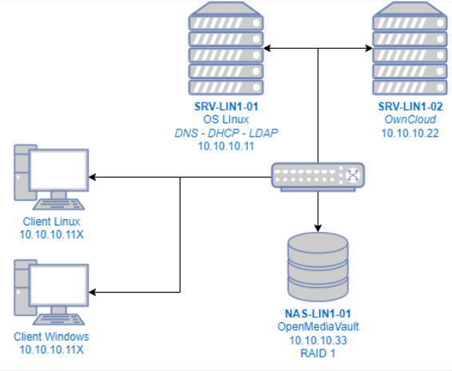

# LIN1-LABO

Scripts d'installation automatisée de l'infrastructure **LIN1-LABO** (module LIN1, CPNV, ES en
ingénierie des systèmes).

Les deux scripts configurent, sur des Debian 12 neuves, les serveurs Linux de l'infrastructure :
DNS, DHCP, annuaire LDAP et passerelle Internet sur **SRV-LIN1-01**, et Nextcloud en HTTPS, avec
ses données sur le NAS, sur **SRV-LIN1-02**.



## L'infrastructure

| Machine | Adresse | Rôle | Configuration |
|---|---|---|---|
| SRV-LIN1-01 | 10.10.10.11 | DNS (BIND9), DHCP, OpenLDAP, LAM, passerelle NAT | [`SRV-LIN1-01.sh`](SRV-LIN1-01.sh) |
| NAS-LIN1-01 | 10.10.10.33 | OpenMediaVault, RAID 1, export NFS `nextcloud-data` | Workbench OpenMediaVault (pas de script) |
| SRV-LIN1-02 | 10.10.10.22 | Nextcloud 34 en HTTPS, LDAP, données sur le NAS | [`SRV-LIN1-02.sh`](SRV-LIN1-02.sh) |
| Clients Linux / Windows | DHCP 10.10.10.100-200 | Postes utilisateurs | à la main |

- Réseau interne : `10.10.10.0/24` (VMware Host-only, sans DHCP VMware). Seul SRV-LIN1-01 a une
  deuxième carte vers Internet (NAT) et sert de passerelle aux autres.
- Domaine `lin1-labo.local`, annuaire `dc=lin1-labo,dc=local`.

## Ce que font les scripts

### `SRV-LIN1-01.sh`

| Étape | Détail |
|---|---|
| 1. Réseau | `ens33` en DHCP (NAT), `ens34` en statique `10.10.10.11/24` |
| 2. Partage de connexion | routage IPv4 + NAT `iptables` (MASQUERADE), règles persistantes |
| 3. DNS (BIND9) | zone `lin1-labo.local` et zone inverse `10.10.10`, forwarders, DNSSEC |
| 4. DHCP | plage `10.10.10.100-200`, passerelle et DNS = SRV-LIN1-01, écoute sur `ens34` seulement |
| 5. LDAP + peuplement | OpenLDAP non interactif, 2 OU, 3 groupes `posixGroup` (avec `memberUid`), 5 utilisateurs avec mot de passe |
| 6. LAM | LDAP Account Manager, profil adapté à l'annuaire |

Annuaire créé :

| Groupe (gidNumber) | Utilisateurs (uidNumber) |
|---|---|
| `manager` (10001) | `man01` (10001), `man02` (10002) |
| `ingenieur` (10002) | `ing01` (10003), `ing02` (10004) |
| `developpeur` (10003) | `dev01` (10005) |

### `SRV-LIN1-02.sh`

| Étape | Détail |
|---|---|
| 1. Réseau | `ens33` en statique `10.10.10.22/24`, passerelle et DNS `10.10.10.11` |
| 2. Partage du NAS | montage NFS `10.10.10.33:/nextcloud-data` sur `/mnt/nas-data` (automount) |
| 3. Serveur web | Apache, MariaDB, PHP 8.2 et ses modules |
| 4. Nextcloud | version 34, HTTPS (certificat auto-signé), URL `/nextcloud`, données dans `/mnt/nas-data/ncdata` |
| 5. LDAP | utilisateurs et groupes de SRV-LIN1-01, quota personnel de 10 Mo |
| 6. Dossiers d'équipe | `Clients`, `Logiciels`, `Commun` : droits par groupe et quotas |
| 7. Espaces Perso | un dossier personnel par utilisateur sur le NAS, visible par lui seul |
| 8. Calendrier | application Calendrier |

Droits appliqués (document « Arborescence des données ») :

| Dossier | manager | ingenieur | developpeur | Quota |
|---|---|---|---|---|
| Clients | lecture / écriture | — | — | 20 Mo |
| Logiciels | — | lecture / écriture | lecture / écriture | 20 Mo |
| Commun | lecture seule | lecture / écriture | lecture / écriture | 30 Mo |
| Perso | personnel | personnel | personnel | 10 Mo (quota utilisateur) |

## Utilisation

### Prérequis

- Deux VM **Debian 12 (Bookworm)** neuves, sans environnement de bureau, avec « serveur SSH » et
  « utilitaires usuels du système ».
- SRV-LIN1-01 : deux cartes, `ens33` = NAT et `ens34` = réseau interne.
  SRV-LIN1-02 : une carte `ens33` = réseau interne.
  Noms différents (`ip link`) : adapter `IFACE_NAT` / `IFACE_LAN` en tête de script.
- Le NAS installé, avec l'export NFS `nextcloud-data` autorisé pour `10.10.10.22`. Avant
  `SRV-LIN1-02.sh`, sur le NAS, en root :

  ```bash
  cd /srv/dev-disk-by-uuid-*/nextcloud-data/
  mkdir ncdata && chown 33:33 ncdata && chmod 770 ncdata
  for u in man01 man02 ing01 ing02 dev01; do
      mkdir perso-$u && chown 33:33 perso-$u && chmod 770 perso-$u
  done
  ```

  (33 = `www-data`. SRV-LIN1-02 ne peut pas créer ces dossiers lui-même : `root_squash`.)

### Lancement

Dans l'ordre : SRV-LIN1-01, puis le NAS, puis SRV-LIN1-02. Les scripts se lancent **depuis la
console de la VM**, pas en SSH : ils changent la configuration réseau.

```bash
su -
bash SRV-LIN1-01.sh
```

```bash
su -
bash SRV-LIN1-02.sh        # 10 à 20 minutes
```

Hors du réseau du CPNV, les DNS de l'école ne répondent pas : passer d'autres forwarders à
SRV-LIN1-01.sh.

```bash
DNS_FORWARDER_1=1.1.1.1 DNS_FORWARDER_2=9.9.9.9 bash SRV-LIN1-01.sh
```

### Résultat

- Chaque script se termine par un **auto-contrôle** qui teste chaque service et affiche `[OK]` ou
  `[ECHEC]`.
- Tout l'affichage est enregistré dans `/var/log/SRV-LIN1-01.log` et `/var/log/SRV-LIN1-02.log`.
- En cas d'erreur, le script s'arrête et indique la ligne fautive.
- Les scripts peuvent être relancés : ils ne créent pas de doublons et ne vident pas l'annuaire.

| Accès | Adresse | Compte |
|---|---|---|
| LAM | http://10.10.10.11/lam | `cn=admin,dc=lin1-labo,dc=local` |
| Nextcloud | https://10.10.10.22/nextcloud | `ncadmin`, ou un compte LDAP (`dev01`…) |

## Étapes volontairement manuelles

- **Authentification SSH par clé** : la clé publique du poste d'administration ne peut pas être
  connue du script. La copier (`ssh-copy-id`), puis `PasswordAuthentication no` dans
  `/etc/ssh/sshd_config`.
- **Utilisateur `dev02`** : sa création fait partie de la démonstration (POC). Ajouté dans LDAP, il
  hérite automatiquement des droits de son groupe et du quota par défaut.

## Choix techniques

- **Nextcloud 34** et non la dernière version : Nextcloud 35 exige PHP 8.3, Debian 12 fournit
  PHP 8.2.
- **Versions figées en secours** (Nextcloud, Team Folders, Calendrier, pris sur GitHub) : l'app
  store de Nextcloud a renvoyé des erreurs 429 depuis le réseau de l'école.
- **Pas de fichiers d'exemple** pour les nouveaux utilisateurs : ils pèsent 63 Mo et
  rempliraient le quota de 10 Mo.
- **Droits par dossiers d'équipe Nextcloud** plutôt que par permissions Unix : Nextcloud accède au
  NAS sous un seul compte (`www-data`), quel que soit l'utilisateur connecté.

## Tests

Les deux scripts ont été exécutés sur des VM **Debian 12.15 vierges**, dans l'ordre
SRV-LIN1-01, NAS, SRV-LIN1-02 :

- auto-contrôle entièrement `[OK]` sur les deux serveurs ;
- SRV-LIN1-02 a reçu son adresse d'installation du DHCP installé par le premier script ;
- vérifications indépendantes en SSH et en WebDAV : DNS, annuaire, droits de chaque groupe,
  fichiers écrits sur le NAS, quotas, espaces Perso, Calendrier, ajout de `dev02`, et retour à
  l'état normal après redémarrage ;
- [ShellCheck](https://www.shellcheck.net/) : aucun avertissement.

La documentation technique complète de l'infrastructure est dans
[`docs/Documentation-LIN1-LABO.pdf`](docs/Documentation-LIN1-LABO.pdf).

## Sécurité

Les mots de passe des scripts (`Pa$$w0rd`) sont des mots de passe de laboratoire imposés par le
module. Ils sont regroupés en tête de chaque script et doivent être changés pour tout autre usage,
tout comme le certificat auto-signé de Nextcloud.

---

Danis Ibrahimovic — CPNV, module LIN1, 2026
